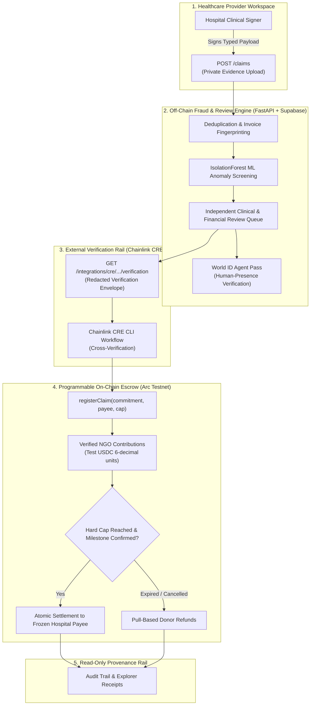

# CARESEAL — SYSTEM ARCHITECTURE & INTEGRATION SPECIFICATION

**Build:** ETHGlobal Mumbai 2026 | **Specification Version:** 2.0  
**Tagline:** Proof before payment.

---

## 1. High-Level Architecture Overview

CareSeal is a shared, privacy-conscious verification and programmable medical-aid settlement layer connecting independent healthcare providers, reviewers, and charitable funding organizations.



---

## 2. Three Integrated Trust Rails

CareSeal incorporates three sponsor programs as essential, non-redundant verification links:

### Rail 1: Arc Studio & USDC Escrow (Settlement Authority)
- **Role:** Sole source of truth for financial transactions, contribution accounting, donor balance tracking, and immutable payout destination.
- **Provenance Requirement:** The prize-relevant smart contract logic MUST originate in **Arc Studio** (`https://studio.arc.io/`) and be tested against Foundry test harnesses.
- **Accounting Invariant:** Escrow contributions are denominated in **6-decimal test USDC** (`1 USDC = 1,000,000 micro-units`). Arc transaction gas is paid in **18-decimal native USDC**.

### Rail 2: World ID Agent Pass (Human-Presence Review Gate)
- **Role:** Guarantees that sensitive clinical and billing approvals (`POST /claims/{id}/reviews`) originate from a living human reviewer rather than automated bots.
- **Verification Requirement:** Server-side zero-knowledge proof verification, nullifier hash deduplication, and single-use challenge nonces.
- **Failure Path Requirement:** Both the verified path and the denied/expired path must be demonstrably enforced; a failed World proof strictly aborts the approval action.

### Rail 3: Chainlink CRE (External Evidence Orchestration)
- **Role:** Coordinates external verifiable medical assessment data with on-chain claim commitments.
- **Simulation Requirement:** A reproducible CLI simulation (`cre simulate`) that reads CareSeal's redacted API envelope (`GET /integrations/cre/claims/{id}/verification`) and verifies the corresponding commitment on Arc Testnet.
- **Firewall:** CRE reports external evidence; it cannot unilaterally bypass the smart contract's two-reviewer requirement or trigger settlement.

---

## 3. Separation of Duties & Authority Model

| Actor / Component | True Authority | What It Cannot Do |
|---|---|---|
| **Hospital Signer** | Proves claim was issued by an authorized hospital key | Cannot prove medical necessity or redirect payout address |
| **ML Model (IsolationForest)** | Identifies anomalous charge distributions against synthetic tariffs | Cannot approve, reject, or disburse funds |
| **Medical Reviewer** | Certifies clinical reasonableness of the itemized procedure | Cannot disburse funds alone or approve own hospital's claims |
| **Financial Reviewer** | Certifies pricing justification against benchmarks | Cannot redirect payee or approve conflicts of interest |
| **World ID Agent Pass** | Proves human presence and prevents automated bot reviews | Does not grant medical credentials or organizational authorization |
| **Chainlink CRE** | Proves deterministic external claim verification status | Does not replace smart contract access controls |
| **Smart Contract (`CareSealEscrow`)**| Enforces cap, frozen payee, dual approval, and atomic settlement | Cannot independently verify real-world surgery |

---

## 4. Multi-Agent Development Architecture

```
careseal/
├── apps/
│   ├── web/                     # Owned by Antigravity (Next.js, RainbowKit, "Proof in Motion")
│   └── api/                     # Owned by Antigravity (FastAPI, ML, Auth, World ID, CRE envelope)
├── contracts/                   # Owned by Claude (Solidity, Foundry, Arc Studio sync)
├── integrations/
│   └── cre/                     # Owned by Claude (Chainlink CRE workflow and CLI simulation)
├── supabase/
│   └── migrations/              # Owned by Antigravity (PostgreSQL schema, RLS policies)
├── docs/                        # Shared specification and audit documentation
└── tools/                       # Local execution binaries (gitignored)
```

- **Conflict Prevention:** No two agents modify the same files.
- **Interface Alignment:** Contract changes and backend endpoints coordinate through documented, non-speculative interfaces.
- **Audit Gate:** Codex reviews contract and sensitive authorization code on an independent audit branch before human merge.

