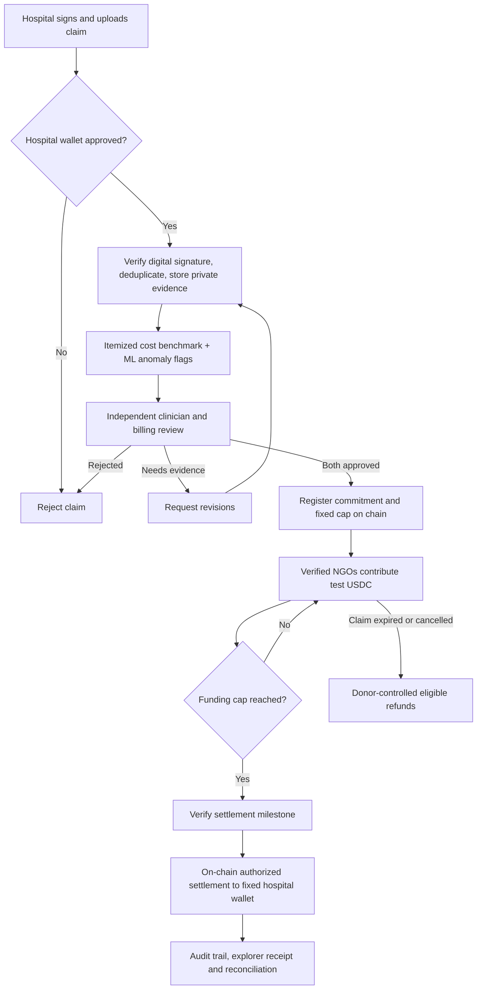
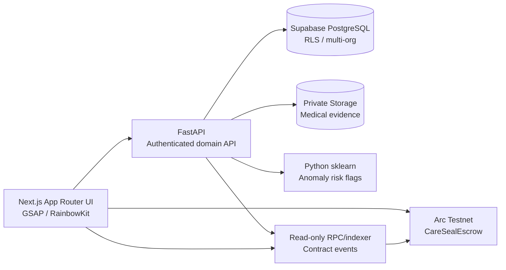
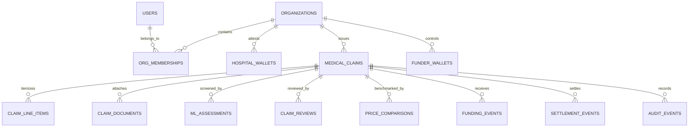

# CARESEAL AI — MASTER PROJECT BLUEPRINT
**ETHGlobal Mumbai 2026 | Build specification v1.0 | 05 November 2026**  
**Tagline:** Proof before payment.  
**Product thesis:** A shared, privacy-conscious verification and programmable medical-aid settlement layer for independent hospitals, reviewers and funding organizations.

> **Scope and honesty:** Hackathon MVP using synthetic medical data and testnet assets. This is not a certified medical-pricing system, a real anti-money-laundering service, a licensed financial intermediary, or an independently audited escrow. No real medical records or real donor funds.

## 1. Project decision: what are we actually building?

CareSeal accepts a hospital-signed medical funding claim, checks the legitimacy of its issuer and uniqueness of its invoice identity, produces an explainable *anomaly flag* against a synthetic benchmark, routes the claim to independent medical and financial reviewers, and then allows verified NGO wallets to contribute **test USDC** to a claim-specific on-chain escrow. The Solidity contract enforces per-claim funding caps, fixed approved hospital payee, separate on-chain authorizations, one-time settlement, expiry/refund behavior and administrative restrictions. A read-only audit timeline exposes non-sensitive financial and approval events.

**Product boundary:** We are NOT building an insurance claims processor, a hospital medical-record system, a crypto crowdfunding marketplace, or an automatic AI diagnosis engine. We are building the **shared claim verification + protected medical funding workflow** that other NGOs could integrate with.

**Three live-demo proofs:** (1) forged hospital claim rejected; (2) NGO A and NGO B fund the same verified claim, NGO C cannot overfund it; (3) an unauthorized account cannot transfer escrowed test funds or change the hospital recipient.

### True sources of authority
- **Hospital registration** proves that an issuer is authorized to create claims; it does *not* prove a treatment was necessary.
- **Cryptographic signature** proves which authorized signing key endorsed a claim; it does *not* prove the invoice is truthful.
- **ML anomaly model** identifies unusual billing patterns; it does *not* prove fraud.
- **Clinical reviewer** establishes the documented *reasonableness* of proposed treatment, not an infallible medical verdict.
- **Financial reviewer** examines applicable pricing references, itemized charges and conflicts of interest.
- **Smart contract** enforces signed/off-chain-approved authorization represented on-chain and the amount/payment constraints; it cannot verify that real-world treatment occurred.
- **NGO wallet ownership** proves control of a wallet, not the lawful source of all crypto funds.

## 2. Users, permissions and views

| Role | Allowed actions | Disallowed actions |
|---|---|---|
| Hospital issuer | Register organizational identity, create/sign draft claim, upload private evidence, view its own claims | Approve own claim, select different payout after registration, unilaterally release escrow |
| Medical reviewer | Read assigned clinical evidence, annotate, approve/deny medical necessity or ask questions | Be affiliated with claim issuer for this approval; release money alone |
| Financial reviewer | Examine itemized bill, reference tariffs, anomalies, cap, approve/deny cost | Approve conflicts of interest; redirect payee |
| NGO/funder | Complete simulated KYB, bind wallet via nonce signature, browse approved claims, deposit test tokens, request eligible refund | Modify claim cap, claim identity, approved hospital recipient, review decisions |
| Security guardian | Emergency pause restricted contract functions | Withdraw arbitrary funds or rewrite records |
| Platform operations | Allowlist demo organizations and manage assigned roles | Access private patient data without relevant role; move escrow to own address |
| Demo public viewer | See scrubbed claim summary, security lab and on-chain explorer receipts | View patient documents or addresses unnecessary for the demo |

**Separation of duties:** Hospital organization, medical reviewer organization and financial reviewer organization must be distinct. The two review decisions must be recorded from different authorized wallets and distinct organizations. For a real deployment, independent corporate/ownership checks are required; unique addresses alone are inadequate.

## 3. End-to-end business workflow



### Example (narrative versus token accounting)
A hypothetical patient needs **₹8 lakh** and has a hospital quote. The system evaluates whether the price is documented and justified. The hackathon ledger is **denominated in test USDC**, not rupees. To avoid fake conversion claims, show INR as contextual clinical estimate and choose a clearly labelled **independent synthetic test-token cap**, or implement a recorded, signed conversion quote if you have time. Never assert that 8 lakh INR equals 8,000 USDC.

**Golden demo:** Hospital H issues claim `CS-DEMO-001`. ML flags a suspicious item; reviewers resolve it. The medical and finance reviewers independently approve. NGO A deposits 300 test USDC; NGO B deposits 200; NGO C tries to add 1 test USDC after a 500 test USDC cap and the contract reverts. An attacker calls `settle()` and receives an authorization revert. An approved milestone allows payment to the **unchangeable registered hospital address**. The audit view displays genuine transaction hashes from the actual test chain.

## 4. System architecture and ownership



**One repository:** Next.js web application; FastAPI services; shared schemas; Foundry smart contracts and tests; docs; approved generated assets. The database stores medical content and workflow records. The chain stores *only* claim commitment, claim cap in token micro-units, approved payee, reviewer authorization state, escrow balances and non-sensitive events. Use chain events as financial source of truth; sync them into PostgreSQL as a read model and reconcile on restarts.

### Technology lock
| Layer | Pick | Rationale |
|---|---|---|
| Website | Next.js + React + TypeScript + Tailwind | Flexible route/layout system, fast iterations |
| Motion | GSAP + ScrollTrigger | Scrollytelling and kinetic headlines; never animate transactional truth |
| UI primitives | Radix/shadcn selectively, Lucide | Accessible dialogs/forms without boxy default visuals |
| Backend | FastAPI + Pydantic | Python-native ML and typed validation |
| Data/auth/files | Supabase Postgres + Auth + private Storage | Quick setup, RLS possible |
| ML | pandas + scikit-learn IsolationForest + deterministic rules | Local anomaly screening without AI API costs |
| Contract | Solidity, OpenZeppelin Contracts 5, Foundry | Security primitives, fuzz and invariant tests |
| Wallet | RainbowKit + Wagmi + Viem + Reown project ID | Wallet UI and signed transactions |
| Chain | Arc Testnet | EVM test network with test USDC; validate exact token details during integration |
| Deployment | Vercel for web; compatible Python server for API | Avoid hosting Python worker logic in a static-only deployment |

## 5. Frontend specification — original cinematic brand

### Design thesis
**“PROOF IN MOTION.”** Borrow the *energy* of expressive typography, tactile physical assets, and original scroll choreography from dontboardme.com—but no copied art, layout, branding or literal dog visuals. Avoid bento grids, endless rectangles, fake charts, gradients, glassmorphism, neon or overused AI-SaaS tropes.

**Palette:** Paper `#EDEBE3`; Ink `#181C1A`; Signal `#FF654A`; Clinical `#A9CFE0`; Verified `#235D4C`.  
**Type:** Archivo Black (headlines), DM Sans (body), IBM Plex Mono (technical snippets).  
**Design primitives:** Oversized condensed headlines, macro spacing, minimal navigation, unboxed evidence annotations, asymmetric full-bleed editorial sections, hairline rules, tangible paper textures, restrained functional color.  
**Accessibility:** readable contrast, explicit focus rings, touch-friendly controls, semantic headings, `prefers-reduced-motion` alternative, informative transaction errors, no motion-only communication.

### Screen and route plan
| Route | Purpose and first-viewport hero | Must-have actions | Distinct motion |
|---|---|---|---|
| `/` | Brand: “EVERY CLAIM. UNDER SCRUTINY.” | Explore, Watch verification, Enter demo | 6-second one-shot unfolding invoice video with poster still; kinetic type, one scroll-linked investigation sequence |
| `/demo` | Step-by-step jury journey | Choose genuine/fake, run checks, continue to escrow | Synthetic claim becomes annotated evidence; deterministic interactive states |
| `/hospital` | Issuer workspace: submit a claim | Upload sample invoice, review itemized lines, sign claim, submit | Document settles into inspection area; never hide form semantics |
| `/claims/[id]` | **Claim Intelligence**: one large document with forensic annotations | Inspect signature, duplicate status, ML flags, price references, clinical review | Thin SVG connectors from fields to explainable review notes |
| `/review` | Separate medical and billing review decisions | Request evidence, approve, reject, record conflict-of-interest | Approval seals appear only after recorded authorized decisions |
| `/funding/[id]` | **Funding Vault**: one amount, one wallet action, one settlement destination | RainbowKit connect, network switch, approve tokens, contribute, view escrow, refund | Funding line advances based on confirmed chain events, never animation alone |
| `/security-lab` | The judge's attack demonstration | Choose attack, execute safe test, open explorer receipt | Split-screen attempted action vs on-chain revert; show unchanged contract balance |
| `/audit/[id]` | Financial/approval event history | Filter timeline, inspect hashes, check status | Temporal scroll reveal, not fake transactions |

**For the MVP, build `/`, `/claims/[id]`, `/review`, `/funding/[id]`, `/security-lab` first.** Hospital upload and audit views can share components with these. Public narrative and clinical review must never resemble the same generic boxed dashboard.

### Landing-page chapter design
1. **Hero / Introduction:** full viewport, original Flow invoice hero video right; huge headline and CTA left; video plays *once*, ending on final-seal frame. No forced replay loop because first and last frames differ. Poster fallback for low bandwidth/reduced motion.
2. **The vulnerability:** “WHEN HELP MEETS FRAUD.” An invoice illustration splits into verified identity versus unsupported expense; one precise fraud narrative without sensationalizing patients.
3. **The examination:** “PROOF BEFORE PAYMENT.” Invoice annotates: issuer signature, duplicate identity, cost comparison, clinical approval, financial approval. Scroll controls editorial lines and labels, but underlying data is loaded from the demo API.
4. **The escrow reveal:** “MONEY MOVES. ONLY WHEN IT SHOULD.” Dark background, the contribution visibly enters vault only after a real testnet receipt; clarify this is test USDC.
5. **The security moment:** “TRY TO BREAK IT.” One click switches to actual attacker flow. Show revert and receipts from deterministic test sequence.
6. **Close:** “TRUST SHOULD BE VERIFIABLE.” Full-bleed signature artwork + enter product.

### Flow assets and asset rules
- **Asset 001:** Original floating paper medical invoice 2K still + generated 6s motion. Use as cinematic hero and poster. Keep readable labels in HTML overlay, not hallucinated image text.
- **Asset 002:** Embossed verification seal still (transparent image preferred) for after-authorized-check reveal; no fabricated trust badge.
- **Asset 003:** Abstract cut-paper red investigation/fraud treatment; 3–4s optional micro-transition.
- **Asset 004:** Dark ink/forest green escrow paper/metal sculptural illustration; optional, use CSS for actual money movement.
- **No** patient likeness, realistic identity documents, medical diagnoses, guaranteed “verified” promises in generated asset. Optimize mp4/webm size and lazy-load beyond hero.
- **Important eligibility:** ETHGlobal Classic track forbids project-specific assets made *before* official hacking kickoff. If the earlier Flow asset predates kickoff, regenerate a fresh in-event version or do not use it in the Classic submission; disclose pre-existing work accurately.

### Consistent UX rules from user's design references
- **Hick's Law:** One primary action per screen, progressive disclosure of evidence.
- **Fitts's Law:** Prominent wallet, verify and review buttons; reachable sizes.
- **Jakob's Law:** Standard transaction approval flow; unfamiliar visual motion never changes payment conventions.
- **Doherty threshold:** Immediate feedback while awaiting ML/RPC confirmation, but distinguish `pending` from `confirmed`.
- **Peak-end rule:** memorable animated “claim verified” and “blocked withdrawal” moments tied to actual signed events.

## 6. Data schema / PostgreSQL logical model



### Required tables and essential fields
| Table | Important columns and constraints | Key principle |
|---|---|---|
| `organizations` | `id`, `name`, `kind` (`hospital`,`ngo`,`reviewer`), `verification_status`, `registered_at` | KYB is separately assessed; a record is not proof of legitimacy |
| `profiles` | `id` links Supabase auth user, display name, created timestamp | Personal identity stays off-chain |
| `org_memberships` | `(organization_id, user_id, role)` unique; status | Role checks, organization isolation |
| `organization_wallets` | `organization_id`, `wallet_address`, `purpose`, `verified_at`, `revoked_at` | Signed nonce + authorized representative links wallet to org |
| `medical_claims` | `id`, `hospital_id`, private `patient_ref`, `hospital_invoice_fingerprint`, `claim_commitment`, `procedure_code`, `estimate_inr_paise`, `approved_cap_token_units`, `token_chain_id`, `status`, payee wallet | Unique hospital + invoice fingerprint; prevent mixing INR and USDC amounts |
| `claim_line_items` | `claim_id`, `category`, `description`, `quantity`, `price_inr_paise` | Item-level anomalies and cost explanations |
| `claim_documents` | `claim_id`, private storage path, media type, SHA-256 integrity digest | No public medical documents |
| `price_comparisons` | `claim_id`, reference source, price low/high, procedure, complexity, source date, synthetic flag | Benchmark contextual; not universal ceiling |
| `ml_assessments` | `claim_id`, model version, raw score, flags JSON, synthetic source, created_at | A score is not a probability of fraud |
| `claim_reviews` | `claim_id`, reviewer org/id, discipline, decision, COI statement, evidence reference, reviewed_at | Unique independent role approvals |
| `funding_events` | `claim_id`, NGO org, donor address, `amount_token_units`, chain ID, tx hash, log index, block number | Database is read model; chain authoritative |
| `settlement_events` | `claim_id`, payee, amount, tx hash, log index, status | Reconcile on-chain receipts |
| `audit_events` | actor, claim, event type, safe metadata, timestamp, linked chain tx | Append-only operations trail; no private PHI in public events |

### Minimum data integrity
- Prefer integer paise and ERC-20 smallest token units; **never floating point for money**.
- Unique `(hospital_id, hospital_invoice_fingerprint)` and unique `claim_commitment`; document hash by itself is insufficient against reordered or slightly modified PDFs.
- Invoice fingerprint should be keyed and privacy preserving. Do **not** put patient name, government ID, raw invoice number, or unsalted low-entropy document hash on-chain.
- `claim_commitment` derived from a confidential, high-entropy random salt and agreed canonical identifiers; on-chain uniqueness protects registered commitments, not arbitrary new dishonest invoices.
- Supabase table RLS: deny-by-default, org-scoped. Separate storage policies for private bucket; use short-lived access controlled signed URLs.
- Claims may be edited while `DRAFT`, but after signing create a new immutable version or signed revision; never silently replace endorsed contents.
- Status transitions are validated server-side and/or on-chain and mirrored consistently.

## 7. Claim state machine and API contract

**Claim states:** `DRAFT -> SUBMITTED -> SCREENED -> NEEDS_REVIEW -> APPROVED -> REGISTERED -> FUNDING -> FUNDED -> MILESTONE_APPROVED -> SETTLED`; terminal alternatives `REJECTED`, `CANCELLED`, `EXPIRED`. Do not allow illegal backwards transitions; a requested revision creates another version.

### FastAPI routes (MVP)
| Route | Who | Behavior |
|---|---|---|
| `GET /health` | public | Liveness only, no credentials exposed |
| `POST /auth/wallet/challenge` | authenticated user | Issue expiring nonce bound to org and domain |
| `POST /auth/wallet/verify` | authenticated user | Validate wallet signature, consume nonce once |
| `POST /claims` | hospital member | Create draft, itemized charges and private patient reference |
| `POST /claims/{id}/documents` | hospital member | Private upload or short-lived signed upload URL with content restrictions |
| `POST /claims/{id}/submit` | authorized hospital wallet | Verify signed canonical payload, duplicate key and freeze revision |
| `POST /claims/{id}/screen` | controlled backend | Run rules/model and persist explainable flags |
| `GET /claims/{id}` | authorized role | Redacted detail by role; no PHI for donors |
| `POST /claims/{id}/reviews` | independent reviewer | Document decision, enforce distinct org/discipline and COI checks |
| `POST /claims/{id}/register-intent` | authorized operator | Prepare public commitment/cap/payee for on-chain transaction |
| `GET /claims/{id}/funding` | authenticated / sanitized public | Read only synced actual on-chain amounts and tx status |
| `GET /claims/{id}/audit` | authorized/redacted | Return provenance and links to real receipts |
| `POST /demo/run-scenario` | synthetic demo mode only | Authorized, rate-limited safe test scenario; no arbitrary call parameters |

**All mutation routes:** authentication + explicit authorization + input validation + max file size + MIME allowlist + audit log + idempotency key where needed. Financial status is always re-read from chain, not accepted from the browser.

## 8. Fraud and integrity engine

### Hospital legitimacy checks
1. Demo hospital onboarding: registered organization; independent test admin confirms identity.
2. Authorized signing wallet verifies a typed, nonce-protected signed claim envelope binding claim ID, invoice reference, estimate and payee, chain ID, expiration.
3. Canonical invoice fingerprint and signed-document digest are checked for exact duplicates and revisions.
4. A signature from a legitimate hospital proves issuer authenticity only; fraudulent hospital/doctor collusion remains possible.

### Medical necessity and pricing
- Require itemized costs: procedure, facility, physician, ICU/stay, devices/implants, tests, medicines, miscellaneous.
- Compare *equivalent* treatments using eligible payer tariffs (where applicable), region, complexity, hospital type and treatment circumstances; benchmark data sources/time stated.
- Flag duplicates, implausible quantities, unusual cost composition, unexplained markup and mismatched procedure codes.
- Qualified independent clinician reviews treatment necessity; independent billing reviewer validates charge justification; explicitly record uncertainty.
- Emergency override **for clinical review scheduling**, not automatic release of funds; use expedited human review to avoid delaying care.

### ML role
- Train IsolationForest on **labeled as synthetic** invoice aggregates or line-item features: procedure family, region, complexity, expected length of stay, line-item mix, procedure cost ratios, historical deviation, repeat frequency.
- Output `flags[]`, `outlier_score`, `model_version`, explanation from transparent rule-engine; do not present numeric output as calibrated fraud probability.
- No external LLM or API key is needed. Model cannot approve, reject or call `settle()`.
- Honest demonstration: seeded true-looking and suspicious synthetic claims; avoid claiming real-world sensitivity/specificity.

### NGO identity and funds risks
- Demo NGO onboarding requires manual KYB record review and *wallet ownership challenge* signed with short-lived nonce and domain binding.
- Contract allowlists approved funder wallets; optionally flag unusual deposit patterns for manual review.
- Full sanctions screening, beneficial ownership and source-of-funds checking require real regulated compliance infrastructure and are out-of-scope for MVP.
- Wallet possession does not prove the NGO is legitimate or the tokens are not stolen.

## 9. Smart-contract specification / security invariants

**Name:** `CareSealEscrow.sol`; one minimal non-upgradeable contract for MVP; OpenZeppelin Security and token wrappers.

**One claim object on-chain:** random `claimCommitment: bytes32`; immutable `hospitalPayee`; `maxAmount: uint256` in **test USDC 6-decimal units**; `raised`, `released`, `expiresAt`, `status`; medical/fiscal approval state; milestone confirmation. The contract token address is fixed at construction; no generic arbitrary asset withdrawals. Persist `contributions[claimId][donor]` for refunds.

### Required methods / operations
- `registerClaim(commitment,payee,cap,expiry)` — authorized registration, nonzero payee/cap, new commitment only; register only after verified issuance; record issuer; prevent changes to payee/cap after registration.
- `approveMedical(claimId)` and `approveFinancial(claimId)` — allowlisted reviewer wallet, distinct independent reviewer organizations and hospital exclusion enforced using role/organization registry. A normal application database decision alone is not enough; the contract must verify authorization.
- `contribute(claimId, amount)` — allowlisted verified NGO wallet; both prior approvals; call `SafeERC20.safeTransferFrom`; disallow amount > remaining cap, after expiry, or paused.
- `confirmMilestone(claimId)` — authorized clinical/financial condition attestation with anti-self-dealing checks; no arbitrary amount or recipient change.
- `settle(claimId)` — funded and milestone-approved, no prior settlement, one transfer to frozen hospital wallet; state-before-external-call; `nonReentrant`.
- `cancelClaim(claimId)` — tightly scoped conditions (rejected, expired, verified cancellation); cannot cancel after settled; no discretionary admin rescue sweep.
- `claimRefund(claimId)` — pull-based donor refunds when eligible. For the MVP use **all-or-nothing settlement**, so refunded balances are unambiguous; test repeated withdrawals and accounting conservation.
- `pause()` / `unpause()` — narrow security guardian + multisig-style admin privileges. Pause semantics for refund recovery must be documented and tested.

### Security properties that must be proven by tests
1. No unapproved wallet can issue, approve, fund (if whitelist required), release, redirect or pause.
2. Issuing hospital and reviewer organizations cannot approve their own claims.
3. Two unique valid reviewers of different disciplines and organizations are required.
4. No claim can receive more than cap and no claim can settle more than once.
5. No arbitrary admin withdrawal, payee replacement or contract upgrade path.
6. Donor refund cannot be claimed twice and no donor can claim another donor's balance.
7. Conservation: **escrow balance accounts for all unsettled deposits less legitimate refunds and settlement**, subject to any gas/token assumptions; test exact token arithmetic.
8. Contract must reject invalid token, zero payee, expired claim, replayed signature, wrong chain ID and invalid state transitions.
9. Reentrancy and external-call failure do not corrupt balances.
10. UI/backend compromise cannot bypass on-chain checks; RPC or UI lies are caught when comparing actual chain receipt.

**Known residual risks:** multi-party collusion, reviewer key theft, real-world falsified invoices, incorrect/low-quality benchmark data, false ML flags, malicious token behavior, chain-level incidents, stolen NGO funds and unverified actual treatment. The hackathon contract is **not audited**. Use only test funds.

## 10. Required API keys and deployment variables

| Credential | Needed where | Secret? |
|---|---|---|
| Supabase project URL and publishable key | Client/server for Auth | Public configuration |
| Supabase privileged secret key OR Postgres server connection | FastAPI only; prefer least-privilege database role | **Secret** |
| Reown / WalletConnect Project ID | Next.js RainbowKit configuration | Public identifier, apply domain restrictions where available |
| Arc Testnet RPC `https://rpc.testnet.arc.io` | Chain client + deployer | Public network endpoint |
| Arc Testnet explorer | Receipt links | Public |
| Dedicated test wallet | Manual signed actions/deployment | Seed/private key **never** sent to agent/chat/committed |
| Circle Faucet test USDC | Demo funding | No private key/API key required to request faucet |
| Scikit-learn | Local model | No API key |

`apps/web/.env.local` example variable names: `NEXT_PUBLIC_SUPABASE_URL`, `NEXT_PUBLIC_SUPABASE_PUBLISHABLE_KEY`, `NEXT_PUBLIC_WALLETCONNECT_PROJECT_ID`, `NEXT_PUBLIC_ARC_RPC_URL`, `NEXT_PUBLIC_CARESEAL_CONTRACT_ADDRESS`, `NEXT_PUBLIC_API_URL`.  
`apps/api/.env` example variable names: `SUPABASE_URL`, `DATABASE_URL`, `ALLOWED_ORIGINS`, `ARC_RPC_URL`, plus any server-only secrets actually used. Never populate real values in `.env.example`.

## 11. Development repo and phases

```text
careseal-ai/
├── apps/
│   ├── web/                 # Next.js pages and motion
│   └── api/                 # FastAPI, fraud rules, ML
├── contracts/               # Foundry Solidity and tests
├── packages/                # Shared JSON schemas/ABIs (optional)
├── supabase/migrations/      # SQL schema and RLS migrations
├── assets/                  # In-event original generated art
├── docs/                    # design, security, API, architecture
├── .env.example             # no keys
├── AGENTS.md                 # agent guardrails
└── README.md
```

### Critical-path schedule after kickoff
| Phase | Time budget | Exit criterion |
|---|---:|---|
| 0. Scope + auth + repo | 0–3h | Git repo, development services running, docs and secrets template |
| 1. Contract skeleton + tests **early** | 3–11h | Claim registration, cap, deposit, role restrictions and blocked withdrawal tested |
| 2. Database/API + signed claims | 11–19h | Hospital claim created, signature verified, exact duplicate rejected |
| 3. Independent reviewers + cost/ML | 19–26h | Synthetic anomaly plus two separate authorized approval actions |
| 4. Wallet + end-to-end escrow | 26–33h | RainbowKit test wallet, actual testnet funding and protected settlement |
| 5. Frontend experience | 33–39h | Beautiful functional demo, accessible hero motion, claim detail and vault |
| 6. Red-team + final submission | 39–48h (or earlier deadline) | Foundry fuzz/invariants, no leaked secrets, recordings, README, real tx evidence |

**Parallelism:** One Antigravity agent owns the web feature branch, one backend agent owns API/DB, Codex independently reviews contracts. No two agents edit identical files. Merge via tested PRs; save explicit Git checkpoints every 2–3h.

**If time slips:** Keep one signed claim, simple deterministic anomalous invoice flag, two reviewers, secure test USDC funding and attack rejection. Cut advanced pricing data ingestion, real KYB integrations, extra cinematic scenes, zero knowledge, multiple milestone tranches, insurance APIs, and third-party analytics.

## 12. Judge-ready demo sequence (3–4 minutes)

1. **Hook (20s):** Forged hospital documents and inflated bills can undermine medical aid; the solution needs to verify *claims and payments*.
2. **Investigation (45s):** Open `CS-DEMO-001`; highlight a medical charge anomaly and the separate signature-authenticity check. Show supporting itemized prices and explain the synthetic benchmark.
3. **Independent decision (35s):** Medical reviewer and billing reviewer wallets approve in separate sessions. Show why the hospital cannot approve itself.
4. **NGO funding (55s):** Connect NGO A and B wallets using RainbowKit; transfer test USDC. Confirm **actual** on-chain balances and funding cap.
5. **Attack proof (40s):** NGO C overfunds and is reverted; attacker wallet calls `settle()` and is reverted. Show tx response or local transaction trace and unchanged escrow, avoid claiming a rejected preflight as a mined revert.
6. **Payout and audit (35s):** Authorize a demonstrated test milestone and settle to fixed hospital recipient; open real explorer receipt; show no patient data leaked.
7. **Close (15s):** “CareSeal does not promise to make dishonesty impossible. It makes verification independent and payments enforceable.”

**Exact demonstration labels:** `TESTNET`, `SYNTHETIC PATIENT`, `SYNTHETIC BENCHMARK`, `DEMO NGO`, `UNVALIDATED ML MODEL`. No fabricated tx hash, medical approval or real organization partnership.

## 13. Launch criteria (no exceptions)

- [ ] Public browser demo works with clean login/role views.
- [ ] Test network and correct token shown before wallet approval.
- [ ] Genuine sample claim signed and created; fake/duplicate claim blocked.
- [ ] Medical vs financial review approvals from distinct simulated organizations.
- [ ] Fake/unknown NGO wallet cannot fund when allowlisting enabled.
- [ ] Actual on-chain donation caps and fixed payee enforce correctly.
- [ ] Unauthorized release and overfunding attacks fail in actual contract tests.
- [ ] Test USDC settlement + refund path tested on local chain (testnet if possible).
- [ ] All fund amounts reconcile between contract and UI; safe pending/failed states.
- [ ] Private evidence remains private; role/tenant and storage policy tests pass.
- [ ] `forge test`, fuzz/invariant tests, `pytest`, `npm run lint`, `npm run build` pass.
- [ ] `.env` and wallet seed leakage checks pass; no real funds used.
- [ ] Project assets/code created within eligible ETHGlobal hacking period or fully disclosed according to selected track.
- [ ] README has architecture diagram, true limitations, deployment details, sources and 3-minute demo video.

## 14. Ready-to-paste Antigravity implementation directive

```text
PROJECT: CARESEAL AI. You are a senior full-stack developer and Web3 security engineer.
Read docs/CARESEAL_MASTER_BLUEPRINT.md as the canonical specification. Do not invent extra scope.

Implement only the assigned phase; before coding enumerate exact files, invariants,
threats and acceptance tests. Never alter escrow permissions to bypass failing tests.
Use synthetic medical data/test funds only. Keep patient information off-chain and
private in Supabase. No real wallet secrets in chat, code, logs or commits.

Frontend: expressive editorial / cinematic hero, original invoice motion,
understated clinical workspaces, RainbowKit, accurate async chain states.
No bento, generic AI-SaaS gradients, glassmorphism, fake security claims.

Contracts: non-upgradeable minimal escrow; OpenZeppelin; frozen payee;
independent approvals; cap; one-time settlement; refunds; emergency pause;
Foundry adversarial, fuzz and invariant tests.

For every feature: PLAN -> IMPLEMENT -> TEST -> SHOW RESULTS -> SECURITY REVIEW -> COMMIT.
Stop and report on any failed security invariant. Do not start the next phase.
```

## 15. Official implementation references

- ETHGlobal event rules: https://ethglobal.com/rules
- Arc/Circle skills network reference: https://github.com/circlefin/skills/blob/master/plugins/circle/skills/use-arc/SKILL.md
- RainbowKit install: https://rainbowkit.com/docs/installation
- OpenZeppelin access controls: https://docs.openzeppelin.com/contracts/5.x/access-control
- OpenZeppelin ERC-20 SafeERC20: https://docs.openzeppelin.com/contracts/5.x/api/token/erc20
- Supabase security and RLS: https://supabase.com/docs/guides/database/secure-data
- Supabase Storage private buckets: https://supabase.com/docs/guides/storage/buckets/fundamentals

**Final note:** The ambition is a *compelling and testable hackathon MVP*, not a guaranteed winning entry or an audited platform. Real funds and real patient data require professional security, medical, financial, legal and privacy review.
